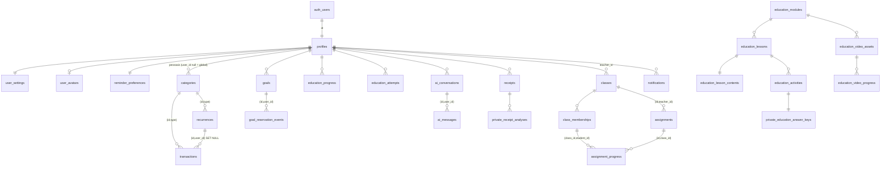

# FinTrack no Supabase — banco PostgreSQL, Auth, Storage e RLS

Projeto Supabase: **Fintrack** (`chzaruypbunxuhftpymj`, us-west-2, PostgreSQL 17).
Data: 17/11/2026. Base analisada: `FinTrack-0.6.1` (FastAPI + SQLite).

Situação em uma linha: **o banco foi criado e testado no projeto Fintrack e o backend foi portado
(`app_supabase.py`) e validado no Supabase real em 24/11/2026; falta o SMTP, a migração dos dados e os vídeos** (seção 12).

| Item | Criado | Testado | Observação |
|---|---|---|---|
| 13 migrações (schemas, tabelas, RLS, RPCs, Storage, jobs, conteúdo) | Sim, aplicadas no Fintrack | Sim (105 verificações, 2 execuções) | Testes em transação desfeita; nada ficou gravado |
| Conteúdo do curso, gabaritos e 16 categorias | Sim | Sim | Gerado de `education_content.py` |
| Buckets `avatars`, `receipts`, `education-videos` | Sim | Políticas sim; envio de arquivo não | Os MP4 ainda não foram enviados |
| pg_cron (recorrências a cada 15 min, manutenção diária) | Sim | Sim: em 24/11 o último job rodou às 12:00 UTC, 0 erros em `job_runs` | |
| Teste de concorrência com 8 requisições | Sim | Sim: `03_concorrencia_api.py` aprovado 3× em 24/11/2026 | `02_…py` (conexão direta) segue opcional: precisa da senha do banco |
| Script de migração SQLite → Supabase | Sim | Só o modo `simular` (banco de QA) | `aplicar` não executado |
| Backend FastAPI usando Supabase (`app_supabase.py`, 72 rotas) | Sim | Sim: `test_supabase_integracao.py` aprovado em 24/11/2026 (contas temporárias apagadas, 0 arquivos restantes) | Seção 8 |

---

## 1. Diagnóstico do modelo atual

Fontes examinadas: `app.py`, `backend_services.py`, `education_content.py`, `video_lessons.py`, `manage_db.py`,
`static/*.js|html`, os testes e o SQLite de QA em `C:\Fintrack_claud\fintrack\.work\qa-browser\fintrack.db`
(27 tabelas, integridade `ok`, migrações 1–3, 4 contas de teste, 1 transação).

- **Persistência:** SQLite com WAL; 23 tabelas de domínio e 5 de autenticação próprias
  (`sessions`, `reset_tokens`, `oauth_states`, `google_pending`, `email_verifications`).
- **Identidade:** senha com scrypt, cookie de sessão HttpOnly, Google OIDC próprio. O papel
  (aluno/professor) é escolhido no cadastro, com código opcional para professor.
- **Dinheiro:** `amount_cents` inteiro; categoria gravada como **texto** (sem FK); reserva de meta via
  `BEGIN IMMEDIATE`.
- **Curso:** conteúdo e gabaritos em código Python (`education_content.py`); correção no servidor; nota mínima
  **70%** (confirmado em `PASS = 70`). A aula só é liberada depois do vídeo introdutório do módulo.
- **Divergências entre versões:**
  - A edição GitHub Pages (`C:\Fintrack_claud\_original`, `pages-common.js`) guardava contas e lançamentos
    no `localStorage` do navegador. **Esses dados não aparecem no banco** (seção 7.3).
  - A 0.6.1 local ganhou um limite de tentativas persistido em SQLite; no Supabase isso vira
    `private.rate_limits`, e o login/cadastro passa a ser limitado pelo próprio Supabase Auth.
  - O SQLite guarda categoria por nome; o Postgres usa `category_id` com FK composta (id, tipo).

## 2. Diagrama ER e dicionário de dados

Dicionário (colunas, tipos, CHECKs e comentários completos estão nas migrações):

| Tabela | Finalidade | Chaves e regras principais |
|---|---|---|
| `profiles` | Nome, papel, onboarding, aceite dos termos | PK = `auth.users.id`; papel gravado uma vez por `complete_onboarding`; `legacy_user_id` para conferência |
| `user_settings` | Tema, gráfico, dicas, alertas, resumo semanal | `weekly_email` só liga se `private.app_settings.email_delivery_ready = true` |
| `user_avatars` | Avatar padrão ou foto | `photo_path` = `<user_id>/...` no bucket `avatars` |
| `reminder_preferences` | Lembretes e limite mensal | `monthly_budget_cents` 0 = sem limite |
| `categories` | 16 globais + pessoais | Único por (dono, tipo, `lower(name)`); pessoal não pode repetir global |
| `recurrences` | Modelo de lançamento recorrente | `end_date >= start_date`; escrita só por RPC |
| `transactions` | Receitas/despesas | `amount_cents bigint > 0`; `occurred_on date`; único (recurrence_id, occurred_on) |
| `goals` / `goal_reservation_events` | Metas e reservas lógicas | Eventos imutáveis, idempotentes, FK composta (goal, dono) |
| `education_*` | Curso, conteúdo, atividades, progresso, tentativas, vídeos | Gabaritos em `private`; conclusão só por `submit_lesson` |
| `ai_conversations` / `ai_messages` | FinBot | Cliente só insere papel `user`; resposta gravada pelo backend |
| `receipts` | Metadados de comprovantes | `sha256` único por conta; caminho no bucket `receipts` |
| `classes`, `class_memberships`, `assignments`, `assignment_progress` | Turmas | Código de 6 hex; consentimento por turma |
| `notifications` | Lembretes no app | Único (user_id, event_key) |
| `private.*` | Configuração, limites, jobs, gabaritos, indicadores, log de e-mail, análises de OCR | Sem GRANT para anon/authenticated |

**CHECK × ENUM:** usamos `text` com CHECK. Acrescentar um valor é um `ALTER` transacional; um ENUM não permite remover
valores e complica migrações.

**Política de exclusão:**
- Excluir a conta (`auth.users`) apaga em cascata todos os dados da pessoa. Essa é a intenção explícita e atende ao
  direito de exclusão da LGPD. Os arquivos do Storage **não** são apagados automaticamente: o backend precisa apagá-los
  junto (pendência).
- Turma excluída pelo professor: remove vínculos, atividades e entregas, mas não toca em dados financeiros.
- Meta: nunca é apagada fisicamente pelo app (status `excluida`, histórico preservado).
- Categoria pessoal em uso: `RESTRICT` impede apagar; o caminho é desativar (`active = false`).
- Apagar uma recorrência mantém os lançamentos já gerados (`SET NULL`).

## 3. Mapeamento SQLite → Supabase

| SQLite | Supabase | Conversão |
|---|---|---|
| `users` (id, name, email, role, created_at, email_verified, google_sub) | `auth.users` (Admin API) + `profiles` | Conta nova sem senha; `email_confirm` = `email_verified`; id antigo em `profiles.legacy_user_id`; aceite dos termos datado no cadastro |
| `users.password_hash/salt`, `sessions`, `reset_tokens`, `oauth_states`, `google_pending`, `email_verifications` | — | **Não migrados**; nova senha por "Esqueci minha senha" |
| `user_settings` (0/1) | `user_settings` (boolean) | `weekly_email` importado **desligado** (reativar após configurar e-mail) |
| `user_avatars.photo_path` (disco) | `user_avatars.photo_path` + bucket `avatars` | Envio com conferência SHA-256 |
| `custom_categories` | `categories` (user_id) | Nome normalizado |
| `transactions.category` (texto) | `transactions.category_id` | Por nome: global → id global; senão categoria pessoal (criada se faltar, registrada no relatório) |
| `transactions.date` (texto ISO) | `occurred_on date` | `date.fromisoformat` |
| `*_cents` (INTEGER) | `bigint` | Sem arredondamento; totais conferidos por conta e tipo antes do commit |
| `created_at` ("…Z") | `timestamptz` | UTC preservado |
| `recurrences` | `recurrences` | Ids preservados (são UUID) |
| `goals` | `goals` | `completed_at`/`deleted_at` = `updated_at` do status |
| `goal_reservations` | `goal_reservation_events` | Ids preservados |
| `education_progress` (module_key, topic_key, answers_json) | `education_progress` (lesson_id) | `uuid5` determinístico; `answers_json` → attempts, last_answers (jsonb), last_score |
| `education_videos` (module, version) | `education_video_progress` (video_id) | `completed_at` = momento da migração (o SQLite não guarda) |
| `conversations` / `messages` | `ai_conversations` / `ai_messages` | Ids e chaves de idempotência preservados |
| `classes.code` | `classes.join_code` | Preservado |
| `memberships` / `assignments` / `assignment_progress` | `class_memberships` / `assignments` / `assignment_progress` | `content_key` → `lesson_id`; `class_id` incluído na entrega |
| `receipts.private_path` | `receipts.storage_path` + bucket `receipts` | Hash conferido contra `content_sha256` |
| `notifications` | `notifications` | `event_key` preservado (sem duplicar avisos) |
| `market_cache` | `private.market_indicators` | Não migrado: o cache se refaz na próxima consulta ao BCB |
| `weekly_email_log.week` | `private.weekly_email_log.iso_week` | Mesmo formato `AAAA-Wss` |

Ordem de importação (respeita as FKs): contas → perfis e preferências → categorias → recorrências → transações → metas →
eventos → progresso do curso e dos vídeos → conversas → mensagens → turmas → vínculos → atividades → entregas →
comprovantes → lembretes → log de e-mail.

## 4. Migrações (`supabase/migrations`)

Os nomes dos arquivos usam as versões registradas no projeto Fintrack (`supabase_migrations`), então `supabase db push` reconhece que já foram aplicadas. A versão aplicada de `fundacao` tem comentários mais curtos que o arquivo; o SQL é o mesmo.

| Arquivo | Conteúdo |
|---|---|
| `20261117132534_fundacao` | Exposição opt-in (revoga GRANTs automáticos), schema `private`, `today_br()` (America/Sao_Paulo), erros HTTP 4xx, `rate_limits`, `job_runs` |
| `20261117132609_identidade` | Perfis, preferências, avatar, gatilho de cadastro à prova de falha, `complete_onboarding`, `skip_avatar` |
| `20261117132659_financas` | Categorias + seed, recorrências, transações, job de recorrência, RPCs com escopo "só esta / esta e próximas" |
| `20261117132735_metas` | Metas, eventos, `reserve_goal`/`withdraw_goal`/`complete_goal`/`delete_goal`, `balance_summary`, `goal_overview` |
| `20261117132853_educacao_e_videos` | Conteúdo, gabaritos privados, correção (porta fiel do Python), progresso, tentativas, vídeos |
| `20261117132913_finbot_e_comprovantes` | Conversas, mensagens, comprovantes, análises privadas |
| `20261117133002_turmas` | Turmas, vínculos, atividades, entregas, participantes, resumo financeiro autorizado |
| `20261117133049_lembretes_indicadores_painel` | Lembretes, indicadores do BCB (cache privado), log semanal, `dashboard()` |
| `20261117133051_storage` | Buckets e políticas |
| `20261117133102_jobs` | `run_job` e agendamento no pg_cron |
| `20261117133330_conteudo_do_curso` | **Gerado** por `scripts/gerar_seed_conteudo.py` |
| `20261117133538_ajustes_advisors` | Índices de FKs compostas, PK em `rate_limits`, políticas de leitura unificadas |

RPCs públicas (todas `SECURITY INVOKER`; a parte privilegiada fica em `private.*` `SECURITY DEFINER` com
`search_path=''`, `auth.uid()` validado e EXECUTE só para `authenticated`): `complete_onboarding`, `skip_avatar`,
`create_recurring_transaction`, `update_transaction_scoped`, `delete_transaction_scoped`, `balance_cents`, `balance_summary`,
`reserve_goal`, `withdraw_goal`, `complete_goal`, `delete_goal`, `education_outline`, `start_lesson`, `check_activity`,
`submit_lesson`, `video_start`, `video_tick`, `preview_class`, `join_class`, `renew_class_code`, `class_participants`,
`class_financial_summary`, `my_notifications`, `mark_all_notifications_read`, `market_indicators`, `dashboard`;
`run_job` só para `service_role`.

## 5. Matriz de permissões (authenticated; anon não tem acesso a nada)

| Tabela | SELECT | INSERT | UPDATE | DELETE | Só por RPC/backend |
|---|---|---|---|---|---|
| profiles | própria + professor/aluno da mesma turma | — (gatilho) | `name` própria | — | papel: `complete_onboarding` |
| user_settings | própria | — (gatilho) | colunas de preferência | — | — |
| user_avatars | própria + mesma turma | só `preset`, própria | só `preset`, própria | — | foto: backend (service_role) |
| reminder_preferences | própria | própria | própria | — | — |
| categories | globais + próprias | própria | `name`, `active`, `position` próprias | própria (RESTRICT se em uso) | — |
| recurrences | próprias | — | — | — | criar/editar/encerrar |
| transactions | próprias | próprias (sem `recurrence_id`) | próprias | próprias | escopo "esta e próximas" |
| goals | próprias | próprias | título/valor/prazo se ativa | — | concluir/excluir |
| goal_reservation_events | próprios | — | — (imutável) | — | reservar/retirar |
| education_modules/lessons | publicados | — | — | — | — |
| education_lesson_contents/activities | só após o vídeo do módulo | — | — | — | — |
| education_video_assets | publicados | — | — | — | — |
| education_video_progress | própria (sem hash de token) | — | — | — | `video_start`/`video_tick` |
| education_progress / attempts | próprios | — | — | — | `submit_lesson` |
| ai_conversations | próprias | próprias | `title` | próprias | — |
| ai_messages | próprias | próprias, papel `user` | — | — (cascata) | resposta da IA: backend |
| receipts | próprios | — | — | próprios | inclusão: backend após validar a imagem |
| classes | professor dono + alunos membros | professor | dono (`name`, `description`, `code_active`) | dono | novo código: `renew_class_code` |
| class_memberships | próprio vínculo + professor da turma | — | aluno: `share_financial` | aluno sai | entrar: `join_class` |
| assignments | professor dono + membros | professor da turma | — | dono | — |
| assignment_progress | aluno: própria; professor: da turma | — | — | — | gatilhos e `submit_lesson` |
| notifications | próprias | — | `read_at` (só marcar) | — | `my_notifications` gera |
| `private.*` | — | — | — | — | service_role / funções definer |

Todas as tabelas de `public` estão expostas pela Data API, com RLS e GRANT mínimo. `private` não é exposto.
`goal_overview` e `assignment_overview` são views `security_invoker`, ou seja, respeitam o RLS de quem consulta.

## 6. Storage

| Bucket | Público | Limite | MIME | Leitura | Envio / troca / exclusão |
|---|---|---|---|---|---|
| `avatars` | Não | 600 KB | jpeg, png, webp | dono + mesma turma | só backend, depois de decodificar com Pillow |
| `receipts` | Não | 5 MB | jpeg, png, webp | só o dono | só backend, depois de decodificar com Pillow |
| `education-videos` | Não | 20 MB | mp4 | qualquer conta autenticada | `migrar_sqlite.py videos` (service_role) |

Os caminhos são `<user_id>/<arquivo>`. Os vídeos ficam em `intro/<modulo>-v1.mp4`. Não há bucket público: a marca continua
em `static/`. O backup do banco **não** inclui os arquivos do Storage (seção 11).

## 7. Migração dos dados antigos (`supabase/scripts/migrar_sqlite.py`)

1. **Antes de tudo:** `manage_db.py backup` do SQLite e um backup do projeto Supabase (Dashboard → Database → Backups,
   ou `pg_dump`).
2. **Simular:** `migrar_sqlite.py simular --sqlite data\fintrack.db --saida relatorio-migracao`. Gera `relatorio.md` e
   `relatorio.json` com o inventário, os órfãos, os duplicados, os valores inválidos e as ações.
3. **Aplicar:** `migrar_sqlite.py aplicar …`, com `SUPABASE_URL`, `SUPABASE_SERVICE_ROLE_KEY` e `SUPABASE_DB_URL` definidos
   **no terminal**.
   - Os dados entram numa única transação, que só é confirmada se os totais por conta e tipo baterem centavo a centavo.
   - Se der erro, a transação é desfeita e as contas recém-criadas no Auth são apagadas.
   - Pode ser reexecutado: contas já migradas são reconhecidas por `legacy_user_id`.
4. **Contas:** criadas sem senha. Cada pessoa usa "Esqueci minha senha", e quem usava Google entra pelo Google, que o
   Supabase vincula pelo e-mail confirmado. Hashes antigos não são compatíveis nem copiados.
5. **Edição GitHub Pages (`localStorage`):** esses dados ficam só no navegador de quem usou.
   Proposta: uma página de exportação que gere um JSON → validação pelo mesmo relatório → importação pela API autenticada
   da própria pessoa. **Não implementado.**
6. **Rollback:** restaurar o backup do passo 1. Para desfazer só a importação, excluir as contas com
   `legacy_user_id is not null`; a cascata remove os dados e os arquivos ficam a apagar no Storage.

Resultado da simulação no banco de QA (17/11): 27 tabelas, integridade `ok`, 0 violações de FK, 1 ocorrência (conta só
Google, que será vinculada no login) e 3 sessões que não serão migradas.

## 8. Backend e interface no Supabase (`app_supabase.py`)

Ative com `FINTRACK_BACKEND=supabase` no `.env` e rode `run.py` como antes. O `app.py` (SQLite) continua disponível como alternativa.

- **Mesmo contrato `/api/*`:** as 72 rotas da 0.6.1 existem e devolvem o mesmo formato, então `app.js` e as demais telas não mudaram.
  Mudaram só três pontos de `login.html`: a mensagem "confirme seu e-mail" no cadastro, o aviso "e-mail confirmado" e o aviso de
  recuperação de senha, que agora usa o e-mail do Supabase.
- **Sessão:** dois cookies HttpOnly (`ft_at` com o access token e `ft_rt` com o refresh token), SameSite=Lax e Secure com `COOKIE_SECURE=1`.
  O backend renova o token sozinho quando ele expira e apaga os cookies se a renovação falhar. A checagem de origem contra CSRF foi mantida.
- **Dados:** toda leitura e escrita pessoal usa o token do usuário, então o RLS vale também no servidor. A chave secreta só entra depois
  que uma chamada com o token confirmou quem é a pessoa: resposta da IA, upload de foto e comprovante (validados com Pillow),
  indicadores do BCB e resumo semanal.
- **Cadastro e papel:** o papel é gravado por `complete_onboarding`. Contas sem papel (Google ou cadastro com confirmação de e-mail)
  passam pela tela "Quase lá" já existente. O código de professor fica em `private.app_settings.professor_signup_code_sha256`.
- **Vídeos:** `/api/intro/{modulo}/media` redireciona para uma URL assinada do Storage, válida por 10 minutos. Enquanto os MP4 não forem
  enviados, usa o arquivo local do pacote. A CSP libera `media-src` só para o domínio do Supabase.
- **Recorrências e manutenção:** rodam no pg_cron. O worker do backend só envia o resumo semanal, e só quando há SMTP configurado.
- **Limites de tentativa:** o login e o cadastro também são limitados pelo Supabase Auth. Os limites do app ficam em memória
  (uma instância por implantação).

**Configuração no painel do Supabase** (17/11: chave secreta, Site URL `http://127.0.0.1:8010` e Redirect URL `http://127.0.0.1:8010/**` feitos; SMTP pendente):
1. *Project Settings → API Keys*: copie a **secret key** para `SUPABASE_SECRET_KEY` no `.env` do servidor.
2. *Authentication → URL Configuration*: Site URL = `APP_BASE_URL`. Redirect URLs: `APP_BASE_URL/login.html*`,
   `APP_BASE_URL/reset.html*` e `APP_BASE_URL/api/auth/google/callback`.
3. *Reset Password*: não precisa mudar nada. `reset.html` aceita o link padrão do Supabase (o token chega no `#` do endereço).
   Opcional, depois de configurar o SMTP (só então o Supabase libera a edição de modelos): trocar o link por
   `{{ .SiteURL }}/reset.html?token={{ .TokenHash }}`, que também funciona.
4. *Authentication → Providers → Email*: "Confirm email" pode ficar ligado (o app mostra "confirme seu e-mail") ou desligado
   (comportamento da 0.6.1, que entra direto).
5. *Authentication → SMTP*: configure um SMTP próprio. O e-mail embutido do Supabase tem limite baixo e serve só para testes.
6. Google (opcional): ative o provedor com o Client ID e o Secret. No Google Cloud, o redirect autorizado passa a ser
   `https://chzaruypbunxuhftpymj.supabase.co/auth/v1/callback`. Depois use `FINTRACK_GOOGLE_ENABLED=1`.

## 9–10. Testes e resultados

`supabase/tests/01_rls_e_regras.sql`: um único bloco que **sempre** termina desfazendo tudo. Executado duas vezes no
projeto Fintrack (antes e depois da migração 0012): **105 verificações aprovadas, 0 falhas**. Depois das execuções, a
consulta de conferência mostrou 0 contas, 0 transações e 0 entradas de limite; ficaram só os dados globais.

O que ele comprova:
- anon sem acesso; gabaritos e cache privados inacessíveis; o papel não pode ser trocado pelo cliente;
- o gatilho de cadastro com erro não bloqueia o cadastro;
- categorias sem duplicar e sem uso de categoria alheia; tipo × categoria; valor zero recusado;
- lançamento futuro fora do saldo; recorrência sem duplicar (job rodado 3 vezes); "esta e próximas" sem mexer no histórico;
- reservar não altera o saldo total, recusa valor acima do disponível, é idempotente com chave e recusa chave reutilizada;
  estados pronta/concluída; excluir libera a reserva;
- resposta da IA não pode ser forjada; vídeo: salto recusado, token falso recusado, conclusão só com tempo real;
- `3.600` e `3600,00` aceitos; nota 50/100; melhor nota preservada; orçamento negativo recusado;
- isolamento entre 2 alunos e 2 professores em todas as tabelas;
- resumo financeiro só com consentimento, só totais, revogação imediata; professor de outra turma bloqueado;
- código desativado recusado; sair da turma remove as entregas;
- lembretes sem duplicar e leitura que não pode ser desfeita; indicadores indisponíveis sem número inventado;
- painel com 6 meses.

`supabase/tests/03_concorrencia_api.py`: 8 requisições simultâneas pela Data API, com o token de uma conta temporária
(o mesmo caminho do app; só usa as chaves do `.env`). **Aprovado 3 vezes em 24/11/2026:**
- mesma chave de idempotência 8× ao mesmo tempo → 1 evento gravado, R$ 10 reservados;
- 8 reservas de R$ 80 com R$ 90 disponíveis → 1 aprovada, 7 recusadas com 422 "O valor excede seu saldo disponível".

`supabase/tests/02_concorrencia_reservas.py` faz o mesmo com 8 conexões diretas ao Postgres (precisa de `SUPABASE_DB_URL`
e do `psycopg`); ficou opcional.

Advisors do Supabase após a 0012:
- Restam avisos informativos esperados: tabelas privadas sem política, que é intencional (só service_role), e índices
  ainda sem uso, porque o banco está vazio.
- `public.rls_auto_enable()` é anterior a estas migrações (gatilho de evento do projeto) e não foi alterada.

## 11. Passo a passo para aplicar e validar (em outro projeto ou do zero)

1. Aplicar os arquivos de `supabase/migrations` em ordem: `supabase db push` com a CLI, ou o SQL Editor, um por vez.
2. Rodar `supabase/tests/01_rls_e_regras.sql` no SQL Editor. O resultado esperado é o erro `TESTES_OK: 105 verificações aprovadas`.
3. Rodar `03_concorrencia_api.py` (ou `02_concorrencia_reservas.py`, com a senha do banco). O resultado esperado é `RESULTADO: OK`.
4. Enviar os vídeos: `migrar_sqlite.py videos`.
5. Configurar: `update private.app_settings set value='true' where key='email_delivery_ready'` (só com SMTP pronto) e,
   se quiser código de professor, `insert into private.app_settings values ('professor_signup_code_sha256', to_jsonb(encode(extensions.digest('<código>','sha256'),'hex')))`.
6. Auth: Site URL, redirect URLs, provedor Google e SMTP próprio, no Dashboard.
7. Backups: os backups do Supabase cobrem o banco. Para o Storage, copie os buckets periodicamente (CLI `supabase storage`
   ou script com a API) e guarde fora do projeto.
8. Monitoramento: `select * from private.job_runs where status = 'erro'`, os erros de autorização (`42501`) em
   `postgres_logs` e as falhas de consulta ao BCB nos logs do backend.

## 12. Pendências, riscos e dependências

- Teste de integração do backend **aprovado em 24/11/2026** (`tests/test_supabase_integracao.py`, 72 s); suíte local: 75 aprovados, 1 pulado.
- Configuração do painel (seção 8) pendente: SMTP próprio e, depois dele, o modelo do e-mail de redefinição.
- Teste de concorrência: aprovado pela API (`03_concorrencia_api.py`); a versão por conexão direta (`02_…`) é opcional.
- Migração dos dados **não executada**. O banco de QA tem só contas de teste e não deve ir para produção.
- Vídeos ainda não enviados ao Storage.
- `EXPLAIN (ANALYZE, BUFFERS)` não foi rodado: com o banco vazio o plano não é representativo. Rodar depois de importar dados.
- Exclusão de arquivos do Storage junto com a conta depende do backend.
- Exportação/importação dos dados `localStorage` da edição GitHub Pages não implementada.
- Dependências externas: SMTP próprio (o e-mail padrão do Supabase tem limite baixo), credenciais Google, provedor de
  IA, serviço de OCR e disponibilidade das APIs do BCB.
